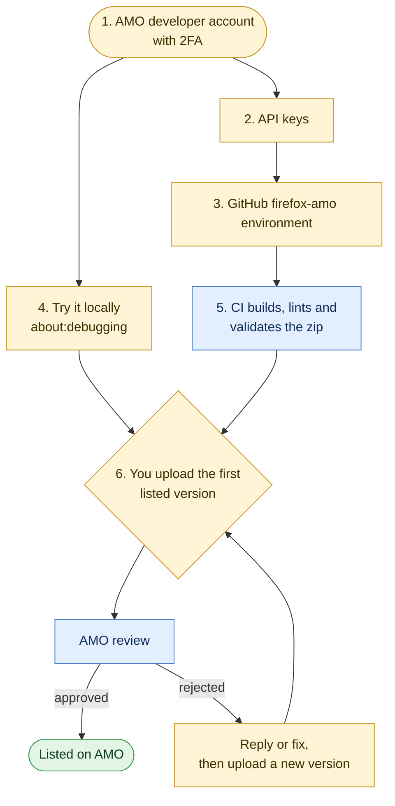

# Getting Voucherboard onto Firefox

The steps from where the Firefox build is now (it builds and lints in CI) to listed on addons.mozilla.org (AMO), for
Firefox on desktop and, without extra code, Firefox for Android. Every step says who does it:

| Tag | Who | Means |
| --- | --- | --- |
| **YOU** | Marius | Only the account holder can do it: accounts, API keys, legal declarations, pressing Submit |
| **CLAUDE** | A coding session | Code or document changes in this repo, on request |
| **CI** | GitHub Actions | Runs by itself, or when you start it |
| **MOZILLA** | AMO reviewers | Waiting time you can't speed up |

Facts about AMO were read on 13 October 2026 from the pages linked. Mozilla changes them, so check a linked page when
a step depends on it.



Yellow is yours, blue is CI or Mozilla, green is the end.

## Already done

- One `manifest.json`, Chrome's. `scripts/lib/firefox-manifest.mjs` makes Firefox's at package time: it drops `key` and
  `version_name`, and adds `browser_specific_settings`:
  - `gecko.id`: `voucherboard@mariusrubin.com`. Never change it: AMO and Firefox's saved data are tied to it.
  - `gecko.strict_min_version`: `140.0`, and `gecko_android.strict_min_version`: `142.0`, the first versions with
    Firefox's built-in data consent.
  - `gecko.data_collection_permissions`: `{ "required": ["none"] }`, which tells users and AMO that nothing is
    collected ([built-in data consent](https://extensionworkshop.com/documentation/develop/firefox-builtin-data-consent/),
    required for new add-ons since November 2025).
- `npm run package:firefox` builds `dist/voucherboard-firefox-<version>.zip`: the same files as the Chrome store zip.
- `npm run lint:firefox` stages it in `dist/firefox` and runs Mozilla's `web-ext lint` on it. It passes with no errors.
  The one warning is the `innerHTML` assignment in `setHTML` in `src/app.js`, the only place markup is parsed; every
  value in it goes through `esc()` (see the reviewer notes in step 6).
- The extension uses only `chrome.storage.local` and `chrome.runtime.getURL`/`getManifest`, which Firefox supports
  under `chrome.*` with promises. Requests to the council run in the page's context in Manifest V3 on both browsers.
  `test/firefox.test.js` checks this list, the manifest and the staged files.
- CI (`ci.yml`) builds and lints the Firefox zip on every push and pull request.
- After each release, if the Firefox files have changed since the last hand-over, `release.yml` runs
  `.github/workflows/firefox-amo.yml`, which waits for your approval (step 5).

## Why CI doesn't upload to AMO

On AMO, creating a listed version submits it for review straight away: there's no draft. `web-ext sign --channel
listed` would therefore break the rule that CI never submits for review. Signing an unlisted (self-distributed) build
isn't a way round it either: AMO version numbers are shared by both channels, so an unlisted 0.5.0 would stop you
uploading 0.5.0 as listed.

So CI does everything short of creating a version: it builds the zip from the release tag, lints it, has AMO's own
validator check it through the upload API (an upload creates no version and submits nothing), and keeps the zip as the
run's artifact. You upload that zip in the Developer Hub.

## 1. Create the AMO developer account **YOU** (about 10 minutes)

1. Go to https://addons.mozilla.org/developers/ and sign in with a Mozilla account. Use voucherboard@mariusrubin.com
   or your own; the account is the add-on's owner.
2. Turn on two-step authentication for the Mozilla account (https://accounts.firefox.com/settings). AMO requires it
   before you can submit.
3. Set your developer profile's display name to "Marius Rubin": it shows as the author on the listing.
4. Read and accept the [Firefox Add-on Distribution Agreement](https://extensionworkshop.com/documentation/publish/firefox-add-on-distribution-agreement/)
   and the [Add-on Policies](https://extensionworkshop.com/documentation/publish/add-on-policies/) when asked.

There's no fee.

## 2. Generate API keys **YOU** (about 2 minutes)

1. Go to https://addons.mozilla.org/developers/addon/api/key/.
2. Press **Generate new credentials**. You get a **JWT issuer** (like `user:12345678:123`) and a **JWT secret**.
3. Save both in your password manager as "AMO API key (Voucherboard CI)". The secret is shown once; if it's lost,
   revoke and generate new ones (that invalidates the old pair).

The key can upload, validate and create versions for every add-on on your account. CI only uses it to validate.

## 3. The GitHub `firefox-amo` environment **YOU** (about 5 minutes)

In the repo: **Settings → Environments → New environment**, name it `firefox-amo`, then:

1. **Required reviewers:** add yourself (`maubergine`). Leave **Prevent self-review** off, so you can approve your
   own runs.
2. **Deployment branches and tags:** **Selected branches and tags**, add `main`.
3. **Environment secrets:**

   | Name | Value |
   | --- | --- |
   | `AMO_JWT_ISSUER` | The JWT issuer from step 2 |
   | `AMO_JWT_SECRET` | The JWT secret from step 2 |

The keys live only there and in your password manager. Never put them in a repo variable, a file or a commit. If
either is missing, the job fails before building anything.

## 4. Try it locally **YOU** (about 10 minutes)

From `voucherboard/`:

```sh
npm run lint:firefox          # stages dist/firefox and lints it
```

Then, in Firefox 140 or later:

1. Go to `about:debugging#/runtime/this-firefox` and press **Load Temporary Add-on…**.
2. Pick `voucherboard/dist/firefox/manifest.json`.
3. Go to `about:addons` → **Voucherboard Beta** → **Permissions**, and check that **Access your data for
   parkingpermits.lewisham.gov.uk** is on. In Manifest V3 this is a host permission the user can turn off; with it
   off, Voucherboard doesn't appear on the council site at all. A listed install asks for it at install time and
   turns it on.
4. Log in at https://parkingpermits.lewisham.gov.uk and press **Voucherboard** in the bottom-right corner.

A temporary add-on is removed when Firefox closes. Its saved data (terms acceptance, plans) is kept for the
add-on id, so it's there the next time you load it.

Or let `web-ext` start a clean Firefox with it loaded:

```sh
npx web-ext run --source-dir dist/firefox --start-url https://parkingpermits.lewisham.gov.uk
```

### Firefox for Android

Firefox for Android runs the same zip; there's no Android-specific code. It hasn't been tried yet. To try it in the
emulator or on a phone with USB debugging, install Firefox, turn on **Settings → Remote debugging via USB**, then:

```sh
adb devices                                  # note the device id
npx web-ext run -t firefox-android --source-dir dist/firefox --adb-device <id> --firefox-apk org.mozilla.firefox
```

Check the permission in Firefox's **Add-ons → Voucherboard Beta → Permissions**, as on desktop. On AMO, tick
**Firefox for Android** under compatibility (step 6) only after it has worked on a phone.

## 5. A release reaches Firefox **YOU** approve it, **CI** does it

After a release on `main`, the `changes` job in `release.yml` says in the run summary whether the Firefox files
(`src`, `guide`, `icons`, `manifest.json` apart from its version, and the Firefox build scripts) changed since the last
release handed over. If they did:

1. The **Firefox / Build and validate for AMO** job waits for your approval of `firefox-amo`. Approve it, or reject it
   to skip this release.
2. It checks out the release tag, runs `npm run package:firefox` and `npm run lint:firefox`, then
   `scripts/amo-validate.mjs`, which uploads the zip to AMO's validator and fails if AMO says it isn't valid.
3. It keeps `voucherboard-firefox-vX.Y.Z` as the run's artifact for 90 days, and notes the next step in the summary.

To build one even though nothing changed (for example after AMO rejected a version):

```sh
gh workflow run release.yml --ref main -f force=firefox
```

## 6. Upload a listed version **YOU** (about 30 minutes the first time, 5 after)

1. Download the `voucherboard-firefox-vX.Y.Z` artifact from the run (**Summary → Artifacts**). It holds
   `voucherboard-firefox-<version>.zip`; upload that zip as it is, without unzipping it.
2. First time: https://addons.mozilla.org/developers/addon/submit/distribution. Afterwards: the add-on's page in
   **My Add-ons → Upload New Version**.
3. **How to distribute:** **On this site** (listed).
4. **Upload** the zip. **Compatibility:** Firefox, and Firefox for Android once tried (step 4).
5. **Source code:** **No**. Nothing is minified, bundled or transpiled; the zip is the source.
6. First time only, the listing:

   | Field | Value |
   | --- | --- |
   | Name | Voucherboard Beta (from the manifest) |
   | Add-on URL | `voucherboard` |
   | Summary | A clearer planner for Lewisham visitor parking vouchers. Runs only on the council's permit site, in your own logged-in session. |
   | Categories | Firefox: **Other**; Android: **Other** |
   | Support email | voucherboard@mariusrubin.com |
   | Support website | https://voucherboard.mariusrubin.com/support.html |
   | Homepage | https://voucherboard.mariusrubin.com/ |
   | Licence | **All Rights Reserved** |
   | Privacy policy | Yes: link https://voucherboard.mariusrubin.com/privacy.html, or paste `PRIVACY.md` |
   | Requires payment, non-free services or software | No (the council charges for vouchers, Voucherboard doesn't) |

   Description (the listing's longer text), from `README.md`:

   > Voucherboard Beta gives the London Borough of Lewisham's visitor parking permit site a clearer planner. Log in at
   > parkingpermits.lewisham.gov.uk and press Voucherboard in the bottom-right corner to see your bookings and unused
   > vouchers on a calendar, plan a week of visits, and book or cancel them in one go.
   >
   > It runs only on the council's permit site, in your own logged-in tab, and makes the same requests as the
   > council's own pages. It never runs on payment or account pages. It has no servers, accounts, analytics or
   > tracking, and collects no data. Your plans are stored in Firefox on your device.
   >
   > An independent tool, not made or endorsed by Lewisham Council. Beta: please report problems at
   > https://github.com/maubergine/voucherboard/issues.

7. **Notes to reviewer** (every version):

   > Voucherboard is a content script for one site, https://parkingpermits.lewisham.gov.uk, the London Borough of
   > Lewisham's visitor parking permit service. It adds a planner over the council's pages and makes same-origin
   > requests to that site only, in the user's logged-in session, as the council's own pages do. It never runs on the
   > payment, buy-again or account pages (exclude_matches), has no background script, no remote code, and collects
   > no data.
   >
   > There's no test account: the site needs a Lewisham resident's visitor permit, tied to an address, and the
   > council doesn't offer test logins. Without one, the planner has no permit data to show. Screenshots and the
   > source on GitHub (https://github.com/maubergine/voucherboard) show what it does.
   >
   > The code is not minified or generated. The innerHTML warning is setHTML in src/app.js, the only place markup
   > is parsed. Its callers build it from template strings, and every interpolated value goes through esc(), which
   > escapes & < > " '. Storage is chrome.storage.local only.

8. Press **Submit Version**. AMO reviews it; a listed version is usually signed and live within a day, and may be
   reviewed by a person later.

## After the first version

- Each new version needs a higher version number than any earlier one on AMO, in either channel. semantic-release's
  versions do that, as long as nothing is uploaded outside this process.
- Firefox updates installed copies from AMO by itself; there's no `update_url`.
- The listing must stay truthful about data: if Voucherboard ever collects or sends anything, change
  `data_collection_permissions` and the terms (`terms.js` section 12) first.
- `PRIVACY.md` says storage is "Chrome's extension storage (`chrome.storage.local`)". Firefox uses the same API, but
  the wording should mention Firefox before the listing goes live; that page is rendered to `docs/privacy.html`.

## Security

- AMO API keys: only in the `firefox-amo` environment, which needs your approval for every run, and your password
  manager. To rotate, generate new credentials on the API key page (that revokes the old pair) and update both
  secrets.
- Nothing CI does with the key creates, changes or submits a version.
- Keep two-step authentication on the Mozilla account: whoever holds it can publish to every Voucherboard user.
