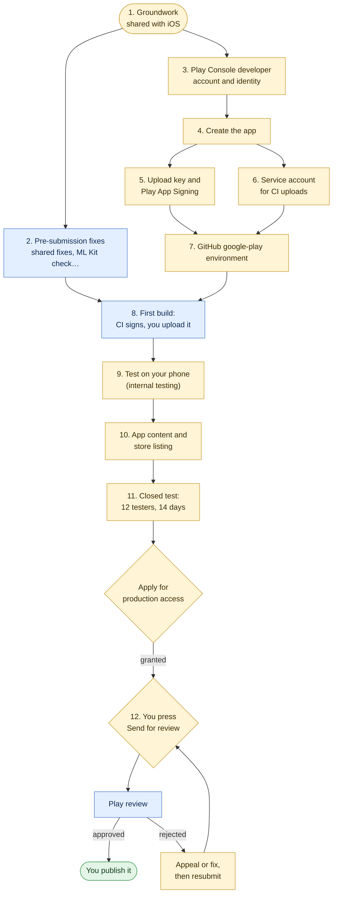

# Getting Voucherboard onto Google Play

The steps from where the Android app is now (it builds in CI and runs on the emulator) to live on Google Play. It's the
Android twin of [APP_STORE.md](APP_STORE.md): the app, its listing and its review story are the same, so steps that are
shared say so rather than repeat them. Every step says who does it:

| Tag | Who | Means |
| --- | --- | --- |
| **YOU** | Marius | Only the account holder can do it: identity, money, legal declarations, signing keys, testers, pressing Send for review |
| **CLAUDE** | A coding session | Code or document changes in this repo, on request |
| **CI** | GitHub Actions | Runs by itself, or when you start it |
| **GOOGLE** | Google | Waiting time you can't speed up |

Facts about Google's rules were read on 12 October 2026 from the pages linked. Google changes them often, so check a
linked page when a step depends on it.



Yellow is yours, blue is Claude, CI or Google, green is the end.

## Already done

- The app is the iOS app's twin: Jetpack Compose screens over the same shared engine and view models
  (`apps/mobile/www/engine.js`, `views.js`), each Compose file mirroring a SwiftUI one (`apps/mobile/android/README.md`).
- It builds on every change in CI (`.github/workflows/android.yml`). The build is linted and checked for the engine and
  council scripts, and fails if ML Kit's telemetry, the advertising id or a photo library permission is in the merged
  manifest.
- After each push to `main` that changes the app, `release.yml` offers a job (`android-play.yml`) that, once you approve
  it, signs a release bundle with the upload key and uploads it to the internal testing track as a **draft**. It never
  sends anything for review and never rolls a release out (step 8).
- Store listing text, reviewer instructions, Data safety and content rating answers and a screenshot plan are in
  `apps/mobile/android/PlayStore/` (see its `README.md`). `test/playstore.test.js` checks the listing.
- `site/PRIVACY.md` covers both phone apps, including what's different on Android. `pages.yml` builds it, with
  `site/SUPPORT.md`, into the website and deploys it to GitHub Pages; tests check every page and link.

## Cost and time

- **Money:** a one-time US$25 registration fee
  (https://support.google.com/googleplay/android-developer/answer/6112435). No yearly fee, unlike Apple. GitHub's
  Linux runners are free for this public repo. Nothing else costs money.
- **Your time:** about a day of your own work in total, mostly steps 3, 5, 9, 10 and recruiting testers for step 11.
- **Google's time:** identity verification takes a few days. **The closed test is at least 14 days** (step 11), then
  Google reviews the production application, "usually within seven days". Reviews of each release are often a day or
  two, sometimes longer for a new account. Plan on three to four weeks from creating the account to being live.

---

## 1. Groundwork **YOU** (shared with iOS)

Do these once for both stores; they're in [APP_STORE.md](APP_STORE.md), step 1:

- **1.2** Check your employment contract.
- **1.3** Where to offer it: **United Kingdom only**. On Play that's the country list in step 12, and the closed test's
  countries in step 11.
- **1.4** Read and save the permit site's own terms.
- **1.5** Ask the council and NSL for written permission (`ios/AppStore/permission-request.md`). One reply covers both
  stores. Play has no 5.2.2 equivalent by number, but its Misrepresentation and Intellectual Property policies cover the
  same ground, and a reviewer may ask what lets the app use the council's service.
- **1.6** The support mailbox, voucherboard@mariusrubin.com. Play shows the contact email on the listing.
- **1.7** GitHub Pages, for the privacy and support pages.

---

## 2. Fixes before the first submission

### 2.1 Shared with iOS **DONE** (CLAUDE)

The fixes made for App Review live in the shared engine and are ported to the Compose screens and the Kotlin shell, so
they apply on Android as they are ([APP_STORE.md](APP_STORE.md), step 2):

| # | Fix | On Android |
| --- | --- | --- |
| a | **Demo mode** ("Try the demo" on the sign-in screen) | Same engine and `demo.js`. Play's reviewers use it: step 10, App access |
| b | **No "beta" in the app**, and the terms version 2026-10-08 | Same terms and wording. Play's Metadata policy has no "beta" rule like Apple's 2.2, but the listing is kept free of it anyway (`test/playstore.test.js`) |
| c | Share extension doesn't open the app | Not needed: on Android, sharing a photo opens the app itself (`ACTION_SEND`) |
| d | **Council view locked** to the council site: taps that leave it, and account registration, open in the browser; payment and 3-D Secure redirects still load | `CouncilView.kt`. Needed for the IARC answer "no unrestricted internet access" (step 10) |
| e | **Privacy policy and support links** in More and under the terms | Same |
| f | **Notification permission** asked after the first booking, when reminders are on | Same; Android 13+ asks for `POST_NOTIFICATIONS` at that point |

### 2.2 Android only

| # | Fix or check | Status |
| --- | --- | --- |
| g | **Phones only.** Tablet and Chromebook layouts haven't been checked; don't add tablet screenshots or opt into large screens at first | **YOU** decide in step 12; nothing to code |
| h | **ML Kit telemetry: a hard blocker.** ML Kit pulls in Google's `datatransport`, which reports usage to Google. The manifest removes its three entry points (`apps/mobile/BRIDGE.md`, "Android telemetry") and CI fails the build if they come back, but that's the community's way of switching it off, not an official setting. Terms section 12 and `site/PRIVACY.md` promise nothing goes to Google. **Before any release, watch the app's traffic on a phone while scanning (step 9). If anything other than `parkingpermits.lewisham.gov.uk` is contacted, stop: don't upload until it's fixed** | **YOU** check, **CLAUDE** fixes |
| i | **Target API level.** New apps and updates must target Android 16 (API level 36) from 31 August 2026, extendable to 1 November 2026 (https://support.google.com/googleplay/android-developer/answer/11926878). `app/build.gradle.kts` has `targetSdk = 36` | Done |
| j | **Exact alarms.** Reminders use `SCHEDULE_EXACT_ALARM`, which the user grants (Settings > Apps > Voucherboard > Alarms & reminders, off by default from Android 14), and fall back to inexact alarms without it. `USE_EXACT_ALARM` is only for alarm, timer and calendar apps and needs a Play Console declaration (https://support.google.com/googleplay/android-developer/answer/16558241), so it isn't used | Done |
| k | **Photos.** The system photo picker needs no permission. Play only allows `READ_MEDIA_IMAGES` when a picker can't do the job (https://support.google.com/googleplay/android-developer/answer/14115180); CI fails if it appears | Done |
| l | **Live Updates** (the Live Activity's Android twin): one per visitor parked now, with a countdown chip in the status bar, a progress bar with a segment per voucher, and Extend; **More > Live Updates** turns them off. It follows Android 16's rules (https://developer.android.com/develop/ui/views/notifications/live-update): Progress style, ongoing, promotion requested, `POST_PROMOTED_NOTIFICATIONS` (granted at install, no declaration), and a use Google lists as suitable: ongoing, user-initiated and time-sensitive. A visit the user swipes away isn't shown again. It's a notification, not a foreground service, so there's no foreground service declaration. Before Android 16 QPR1 (API 36.1) it shows as an ordinary ongoing notification. Checked in the emulator on 36.1: Android marks it `PROMOTED_ONGOING` | Done |
| m | **App icon.** The launcher's adaptive icon and the 512 × 512 Play icon (`PlayStore/metadata/android/en-GB/images/icon.png`) are the iOS icon's white V on navy (`#2b4972`). `test/playstore.test.js` checks the Play icon's size and format | Done |
| n | **Bank holidays after 2027** in `extension/src/zones.js` (APP_STORE.md fix 2h) | Still to do; not a review issue |

---

## 3. The developer account **YOU** (about 30 minutes, then a few days of waiting)

### 3.1 Personal or organisation

Recommendation: a **personal** account, as with Apple's individual enrolment.

- An organisation account needs a D-U-N-S number for a registered business. A personal one needs only you.
- **The catch: personal accounts created after 13 November 2023 must run a closed test with at least 12 testers,
  opted in for 14 consecutive days, before they can publish to production**
  (https://support.google.com/googleplay/android-developer/answer/14151465). Organisation accounts don't. Step 11 is
  that test. Start lining up testers now.
- If you later set up a company to sell Voucherboard, the app can be moved to the company's account with Play's app
  transfer, without users losing it.

### 3.2 Before you start

- **A Google Account** for it. A new one just for Voucherboard keeps its email, payments and 2-step prompts apart from
  your personal account; whichever you use becomes the account owner for as long as the app exists. Turn on 2-Step
  Verification. Don't use a work account.
- **Your legal name and address**, as on your ID. You "may be asked for a valid government ID and a credit card, both
  under your legal name"; if it doesn't check out, the fee isn't refunded.
- **An Android phone** you can sign in to with that account: new personal accounts "must also verify access to an
  Android device through the Play Console mobile app".
- **A card** in your name. Prepaid cards aren't accepted.

### 3.3 Register

1. https://play.google.com/console/signup, signed in with the account from 3.2.
2. Choose **Yourself** (personal account).
3. **Developer name:** `Marius Rubin`, to match the App Store's seller name. It's shown on the listing.
4. Contact details: voucherboard@mariusrubin.com as the developer email shown to users; your own phone and email for
   Google to reach you. Verify both when asked.
5. Answer the questions about your experience and the apps you plan to publish honestly: one free app, a planner for a
   UK council service.
6. Pay the US$25 fee.
7. Upload your ID when asked, and wait for verification (usually a few days; Google emails you).
8. Install **Google Play Console** on your Android phone, sign in, and complete the device check.

### 3.4 Android developer verification

From 2026, Android itself checks that apps on certified devices come from a verified developer. Enforcement starts on
30 September 2026 in Brazil, Indonesia, Singapore and Thailand and spreads worldwide in 2027
(https://developer.android.com/developer-verification). For a Play developer this is the identity check in 3.3: Google
says Play "automatically registers 99% of apps", and a verified Play account needn't verify again. Once the app exists
(step 4), check **Settings > Developer account** and the app's package name registration in Play Console say it's
registered. If a page asks you to register `com.mariusrubin.voucherboard` yourself, do: it's the only package name.

### 3.5 After Google confirms

- **Settings > Developer account > Account details:** check the developer name and that the account type is personal.
- **Digital Services Act:** Play Console asks whether you're a trader in the EU. With UK-only distribution and a free
  app, answer **not a trader**, as for Apple (APP_STORE.md 1.3). Revisit if you charge for it.
- **Notifications:** Settings > Notifications, turn on emails for policy, review and release status.

---

## 4. Create the app **YOU** (about 5 minutes)

Play Console > **Home > Create app**:

| Field | Value |
| --- | --- |
| App name | Voucherboard |
| Default language | English (United Kingdom), en-GB |
| App or game | App |
| Free or paid | **Free**. It can't be changed to paid later |
| Declarations | Tick the Developer Program Policies and US export laws declarations |

The package name isn't asked for here: it's fixed by the first bundle you upload (step 8), and is
`com.mariusrubin.voucherboard` (`app/build.gradle.kts`, the same as the iOS bundle id). It can never change.

---

## 5. Upload key and Play App Signing **YOU** (about 10 minutes, once)

New apps must use Android App Bundles and **Play App Signing**: Google holds the key that signs what users install,
and you sign each upload with your own **upload key**. If the upload key is lost or leaks, Google can reset it
(Play Console > Test and release > App integrity); the app signing key never leaves Google.

Work in a folder outside any repo, and delete it at the end. `.gitignore` refuses `*.jks` and `*.keystore`.

```sh
umask 077 && mkdir vb-play && cd vb-play
openssl rand -base64 30        # the keystore password: save it in your password manager
keytool -genkeypair -v -keystore upload.jks -storetype PKCS12 -alias upload \
  -keyalg RSA -keysize 4096 -validity 10000 \
  -dname "CN=Marius Rubin, O=Voucherboard, C=GB"
keytool -list -v -keystore upload.jks -alias upload | grep 'SHA256:'
```

- PKCS12 keystores use one password for the store and the key: give the same one to both prompts, and to both
  `ANDROID_UPLOAD_STORE_PASSWORD` and `ANDROID_UPLOAD_KEY_PASSWORD` in step 7.
- `-validity 10000` is about 27 years; Android's signing guide recommends 25 years or more.
- Note the SHA-256 fingerprint: CI checks every bundle against it.
- Save `upload.jks` and its password in your password manager.

Play App Signing itself is set up in step 8: on the first upload, choose **Use Google-generated key** (the default).

---

## 6. A service account for CI uploads **YOU** (about 15 minutes)

CI uploads with a service account in **your existing Google Cloud project**, the one that already holds the Chrome Web
Store upload. It gets a short-lived token per run through Workload Identity Federation, so there's no JSON key to store
or leak.

Play gets **its own service account and its own identity provider**. Nothing of the Chrome Web Store's is reused or
changed:

| | Chrome Web Store (as now) | Google Play (new) |
| --- | --- | --- |
| Service account | `CWS_SERVICE_ACCOUNT` | `voucherboard-play@PROJECT.iam.gserviceaccount.com` |
| Identity provider | `GCP_WIF_PROVIDER`, in pool `POOL` | `github-play`, in the same pool |
| Who can get a token | Its own condition, unchanged | Only jobs in this repo's `google-play` environment |
| What it can do | Upload to the Chrome Web Store | Release Voucherboard to Play's testing tracks |

So a Play job can't act as the Chrome Web Store account, and the other way round. Neither account has any Google Cloud
role in the project.

Replace `PROJECT` with the project id and `POOL` with the existing pool's id. To find them:

```sh
gcloud projects list
gcloud iam workload-identity-pools list --project PROJECT --location global
```

1. Enable the **Google Play Android Developer API** in the project:

   ```sh
   gcloud services enable androidpublisher.googleapis.com --project PROJECT
   ```

2. Add a provider just for Play, in the existing pool. Its condition admits only GitHub's tokens for this repo's
   `google-play` environment:

   ```sh
   gcloud iam workload-identity-pools providers create-oidc github-play \
     --project PROJECT --location global --workload-identity-pool POOL \
     --display-name "GitHub Voucherboard Play" \
     --issuer-uri "https://token.actions.githubusercontent.com" \
     --attribute-mapping "google.subject=assertion.sub,attribute.repository=assertion.repository,attribute.environment=assertion.environment" \
     --attribute-condition "assertion.repository == 'maubergine/voucherboard' && assertion.environment == 'google-play'"
   gcloud iam workload-identity-pools providers describe github-play \
     --project PROJECT --location global --workload-identity-pool POOL --format "value(name)"
   ```

   The last command prints the provider's resource name
   (`projects/PROJECT_NUMBER/locations/global/workloadIdentityPools/POOL/providers/github-play`). It goes in
   `PLAY_WIF_PROVIDER` in step 7. Leave the Chrome Web Store's provider as it is.

3. Create the Play service account, and let only tokens from that provider act as it:

   ```sh
   gcloud iam service-accounts create voucherboard-play --project PROJECT \
     --display-name "Voucherboard Google Play uploads"
   gcloud iam service-accounts add-iam-policy-binding \
     voucherboard-play@PROJECT.iam.gserviceaccount.com --project PROJECT \
     --role roles/iam.workloadIdentityUser \
     --member "principalSet://iam.googleapis.com/projects/PROJECT_NUMBER/locations/global/workloadIdentityPools/POOL/attribute.environment/google-play"
   ```

   Give it no project roles, and **don't create a key for it**. Don't add the Chrome Web Store's service account to
   Play, or this one to the Chrome Web Store.

4. Play Console > **Users and permissions > Invite new users**: `voucherboard-play@PROJECT.iam.gserviceaccount.com`.
   Under **App permissions**, add Voucherboard only, and tick **Release apps to testing tracks** only. Leave every
   account permission off. That's enough to upload bundles and make draft releases on the internal track; it can't
   release to production, change the listing or see other apps.
   Play no longer needs the developer account linked to the Cloud project; if Play Console shows **Setup > API access**,
   link the project there.

It can take up to a day after the invite before the API accepts the account.

**Check:** `gcloud iam service-accounts get-iam-policy voucherboard-play@PROJECT.iam.gserviceaccount.com` shows one
binding, `roles/iam.workloadIdentityUser`, for `attribute.environment/google-play`; and
`gcloud projects get-iam-policy PROJECT --flatten bindings[].members --filter "bindings.members:voucherboard-play"`
shows nothing.

---

## 7. The GitHub `google-play` environment **YOU** (about 10 minutes)

Repository **Settings > Environments > New environment** `google-play`:

1. **Required reviewers:** add yourself (`maubergine`). Leave "Prevent self-review" off. Every signing run then waits for
   your approval.
2. **Deployment branches and tags:** Selected branches: `main`.
3. From the `vb-play` folder, with the GitHub CLI, so nothing passes through the clipboard:

```sh
R=maubergine/voucherboard
base64 -i upload.jks | gh secret set ANDROID_UPLOAD_KEYSTORE --repo $R --env google-play
gh secret set ANDROID_UPLOAD_STORE_PASSWORD --repo $R --env google-play   # paste the password when asked
gh secret set ANDROID_UPLOAD_KEY_PASSWORD   --repo $R --env google-play   # the same password
gh variable set ANDROID_UPLOAD_KEY_ALIAS    --repo $R --env google-play --body upload
gh variable set ANDROID_UPLOAD_CERT_SHA256  --repo $R --env google-play --body "<SHA256 from step 5>"
gh variable set PLAY_WIF_PROVIDER           --repo $R --env google-play --body "<github-play's resource name, step 6.2>"
gh variable set PLAY_SERVICE_ACCOUNT        --repo $R --env google-play --body "voucherboard-play@PROJECT.iam.gserviceaccount.com"
```

(On Linux, `base64 -w0 upload.jks`.) Then check `upload.jks` and its password are in your password manager, and delete
the folder: `cd .. && rm -rf vb-play`.

| Name | Kind | Value |
| --- | --- | --- |
| `ANDROID_UPLOAD_KEYSTORE` | secret | The base64 upload keystore |
| `ANDROID_UPLOAD_STORE_PASSWORD`, `ANDROID_UPLOAD_KEY_PASSWORD` | secrets | Its password (the same for both) |
| `ANDROID_UPLOAD_KEY_ALIAS` | variable | `upload` |
| `ANDROID_UPLOAD_CERT_SHA256` | variable | The upload certificate's SHA-256 fingerprint |
| `PLAY_WIF_PROVIDER` | variable | The `github-play` provider from step 6 (not the Chrome Web Store's `GCP_WIF_PROVIDER`) |
| `PLAY_SERVICE_ACCOUNT` | variable | The service account's email from step 6 |
| `PLAY_API_UPLOADS` | variable | Leave it unset until the first release is in Play Console (8.1), then `true` |

`PLAY_WIF_PROVIDER` and `PLAY_SERVICE_ACCOUNT` are needed only once `PLAY_API_UPLOADS` is `true`; signing works
without them.

---

## 8. Build, sign and upload **YOU** approve it, **CI** does it

Every push to `main` runs `release.yml`. If the app's files have changed since the last upload (docs/RELEASING.md,
"What counts as a change"), it offers a Google Play upload. `feat/android-compose` has to be merged into `main` first
(pull request, CI green). To offer one anyway, for the first build or a rebuild:

```sh
gh workflow run release.yml --repo maubergine/voucherboard --ref main -f force=android
```

Or **Actions > Release > Run workflow**, choose `android` under **force**. Then:

1. **CI** checks again for changes, in case an earlier run has just uploaded the same files.
2. The **Upload to Google Play** job waits for you: open the run, **Review deployments**, tick `google-play`,
   **Approve**. Reject it to skip this upload.
3. **CI** checks every setting is present, writes the keystore to the runner's temp folder with owner-only permissions,
   builds `app-release.aab` of the latest release tag with `manifest.json`'s
   version and 100 plus the release run's number as `versionCode`, and checks it's signed by the upload certificate you
   gave. The keystore is deleted at the end, pass or fail.

### 8.1 The first release: CI signs it, you upload it

Google's API can't create an app's first release: the first bundle has to go through Play Console by hand. While
`PLAY_API_UPLOADS` is unset, step 3 ends by keeping the bundle as the run's artifact for 14 days, and uploads nothing.

1. Download the artifact (`gh run download <run id>`, or the run's page), and unzip it.
2. Play Console > Voucherboard > **Test and release > Testing > Internal testing > Create new release**. When asked
   about app signing, choose **Use Google-generated key**. Upload the `.aab`, paste
   `PlayStore/metadata/android/en-GB/changelogs/default.txt` as the en-GB release notes, **Next > Save**. Don't roll it out
   yet if Play Console asks for the App content declarations first (step 10); come back after.
3. **Testers:** Internal testing > **Testers** > create an email list "Me" with your own Google account; copy the
   opt-in link and open it on your phone. Internal testing has no review, and Google says builds reach testers within
   minutes.
4. Turn on uploads:
   `gh variable set PLAY_API_UPLOADS --repo maubergine/voucherboard --env google-play --body true`.

### 8.2 Every build after that

With `PLAY_API_UPLOADS` set to `true`, after your approval **CI** does step 3, then gets a short-lived token through
Workload Identity Federation and runs `apps/mobile/android/scripts/play-upload.sh`: it opens an edit, uploads the bundle,
puts it on the **internal** track as a release with status **draft**, adds the release notes, and commits the edit. A
draft isn't served to anyone. You then open **Internal testing**, check the draft and press **Start rollout to
Internal testing**.

Why only drafts on the internal track: the same rule as the Chrome Web Store and TestFlight. CI can put a build where
you can try it, but only you decide what reaches anyone else. The service account can't release to production either
(step 6), and the script never sets a release to `inProgress` or `completed`. Each run makes a new `versionCode`; Play
refuses one it has seen before.

---

## 9. Test on your own Android phone **YOU**

The app has never run on a phone or against the live council site. Install it from the internal testing opt-in link
(through the Play Store, so it's the Google-signed build). Test as in [APP_STORE.md](APP_STORE.md) step 9, with **Test
mode on** until the last part: basics, planning in test mode, phone features, one real booking, sign out. On Android,
also check:

**The ML Kit check (fix 2h, a hard blocker).** Watch every connection the app makes while you scan:

1. Install HTTP Toolkit (https://httptoolkit.com) on a computer, connect the phone with USB debugging on, and choose
   **Android device via ADB**; or use PCAPdroid from the Play Store on the phone itself, filtered to Voucherboard,
   which needs no computer.
2. Scan with the camera, choose a photo, and share a photo to Voucherboard, each a few times. Then leave the phone
   idle for an hour with the app installed, and check again: datatransport batches its uploads.
3. The only host should be `parkingpermits.lewisham.gov.uk`. If anything goes to `firebaselogging*.googleapis.com`,
   `play.googleapis.com` or any other Google host, stop and tell Claude. Nothing ships until it's fixed.
4. Also check that scanning works in flight mode the first time (the model is bundled).

**Android features.**

- Reminders: allow notifications after the first booking. On Android 14 or later, turn on **Settings > Apps >
  Voucherboard > Alarms & reminders**, so reminders come on time; without it they can be a few minutes late.
- **Extend 1 hour** from the reminder opens Book a visitor, filled in.
- The **Live Update** shows while a visitor is parked: a countdown chip in the status bar, and on the lock screen and at
  the top of the shade a progress bar with Extend. It goes when the visit ends, even with the app closed. **More > Live
  Updates** turns it off; if it's off in Android's settings, More says so and links there. Phones on Android 15 or
  earlier show an ordinary ongoing notification instead.
- The back button closes sheets, steps back in the council view, and closes the scanner.
- Turn the phone sideways for the board; try dark mode (More > Appearance).
- Reboot the phone with a reminder pending: it should still arrive.
- Share a photo from Google Photos and from Files, with the app closed and open: Book a visitor opens with the plate.

If anything fails, Claude fixes it; once the fix is on `main`, approve the upload it offers (8.2). Each run makes a new
version code.

---

## 10. App content and the store listing **YOU** (about an hour)

Everything to paste is in `apps/mobile/android/PlayStore/`. Play Console lists what's outstanding on the
**Dashboard**; all of it must be done before the closed test can be reviewed.

### App content (Policy and programs > App content)

| Declaration | Answer |
| --- | --- |
| Privacy policy | `PlayStore/privacy_url.txt` |
| App access | **All or some functionality is restricted** > add instructions: no username or password, paste `review_information/app_access.txt`. Google asks for "an active demo account" or "additional instructions or access details" (https://support.google.com/googleplay/android-developer/answer/15748846); demo mode is the instructions route. Trim to the field's counter if needed |
| Ads | **No, my app does not contain ads** |
| Content rating | The IARC questionnaire, as in `content-rating.md`. Required: "Apps without a content rating will be removed" (https://support.google.com/googleplay/android-developer/answer/9898843). Expect PEGI 3 |
| Target audience and content | **18 and over** only, and not appealing to children (`content-rating.md`) |
| Data safety | **No data collected or shared**, with the reasoning in `data-safety.md` |
| Advertising ID | **No** |
| Government apps | **No**: it isn't made by or for a government. See below |
| Financial features | **None** (Play asks every app) |
| Health | **None**, if Play Console lists the Health apps declaration |
| News | **No** |

**Government information.** Google's rule for apps "not affiliated with a government entity" that communicate
government information: put "easy-to-see information sources in your app's description and store listing page", and
make clear the app "doesn't represent a government or political entity"
(https://support.google.com/googleplay/android-developer/answer/9514050). The full description has a **Where the
information comes from** section naming the council's site and its published pages, and says Voucherboard "doesn't
represent the council or any government body". `test/playstore.test.js` keeps both there. The app's first screen and the
terms say the same.

### Main store listing (Grow users > Store presence > Main store listing)

| Field | Value |
| --- | --- |
| App name | `metadata/android/en-GB/title.txt` (30 characters) |
| Short description | `short_description.txt` (80) |
| Full description | `full_description.txt` (4,000) |
| App icon | `images/icon.png`, 512 × 512 (fix 2m). Upload it as it is: Play rounds the corners itself |
| Feature graphic | 1024 × 500 (`screenshots.md`) |
| Phone screenshots | 2 to 8, made in demo mode (`screenshots.md`). **CLAUDE** can make them on the emulator |

Limits from https://support.google.com/googleplay/android-developer/answer/9866151 (short description, graphics); the
30-character title, 4,000-character description and 500-character release notes are Play Console's own field limits.

### Store settings

- Category: **App**, `category.txt` (Travel & Local; Auto & Vehicles also fits). Tags: parking, travel.
- Contact details: `contact_email.txt` (shown publicly), website `website_url.txt`.

---

## 11. Closed test and production access **YOU** (at least 14 days)

The rule for new personal accounts: "At least 12 testers must be opted in to your closed test when you apply for
production access", opted in "continuously for the preceding 14 days"
(https://support.google.com/googleplay/android-developer/answer/14151465). Someone who opts out and back in restarts
their 14 days.

1. **Find 15 or more testers** (a margin over 12): friends, family, neighbours with visitor permits. Each needs a
   Google account and an Android phone. They don't need a council account: demo mode is the whole app. Ask them to keep
   the app installed and open it every few days; Google can refuse production access for "insufficient tester
   engagement".
2. **Test and release > Testing > Closed testing > Create track** (or use the default **Closed testing - Alpha**).
   Countries: **United Kingdom**. Testers: a Google Group or an email list with their addresses.
3. Promote the internal build to it (**Promote release > Closed testing**), or create a release with the same bundle.
   **Send for review** in **Publishing overview**: closed releases are reviewed, often within a day or two.
4. Send testers the opt-in link once it's approved. Check **Closed testing > Testers** shows them as opted in.
5. Ask testers for feedback through the Play Store's private feedback, or email. Fix what they find (step 8.2 then
   promote), which also gives the application something to describe.
6. After 14 days with 12 or more opted in: **Dashboard > Apply for production**. Answer the three sections (about the
   closed test, the app, production readiness) plainly: who tested, what they found and what changed, that it's a free
   planner for Lewisham visitor permits with a demo mode. Google "usually" replies within seven days.

---

## 12. Production **YOU**

1. **Production > Countries / regions:** **United Kingdom** only.
2. **Publishing overview > Managed publishing: on.** Approved changes then wait for you to press **Publish**, like
   "Manually release this version" on the App Store.
3. **Production > Create new release**, choose the closed-test bundle (or promote it), release notes from
   `changelogs/default.txt`, then **Send for review**.
4. Checklist before sending:
   - [ ] Step 1.4 and 1.5 done (shared with iOS).
   - [ ] Fix 2h's traffic check passed on this build, or one with no Android changes since.
   - [ ] You've done step 9 on this build.
   - [ ] The privacy and support URLs open without signing in.
   - [ ] Screenshots are from demo mode, with no real plates and no council branding.
   - [ ] Phones only (fix 2g): no tablet screenshots; in **Advanced settings > Form factors** nothing beyond phone.
5. When it's approved, press **Publish** in Publishing overview. It appears on the store within hours.

CI never sends for review or publishes: these buttons are yours, as with the App Store and the Chrome Web Store.

**If Play rejects or suspends something** (an email, and Play Console > **Policy status**):

1. Read which policy it cites. Most first-time rejections are listing or declaration issues (App access, Data safety,
   Misleading Claims), fixed in Play Console without a new build.
2. Send it to Claude for a fix or a draft reply. `ios/AppStore/REVIEW_BRIEF.md` has the answers for the council-site
   questions; the same facts hold on Android.
3. You can appeal from **Policy status** if you think it's wrong. Don't resubmit the same thing repeatedly: repeated
   rejections count against a new account.

### Updates

1. Changes merge to `main` as usual; `release.yml` cuts the version (semantic-release).
2. Approve the Google Play upload `release.yml` offers (step 8.2), roll the draft out to internal testing, test it, then
   **promote** it to production and send for review. Personal accounts don't need another closed test for updates.
3. Release notes: update `changelogs/default.txt` in the same pull request.

### What expires

| What | When | What to do |
| --- | --- | --- |
| Developer account | Doesn't expire. Google closes inactive accounts that haven't published or signed in for a long time, after warning by email | Sign in a few times a year; keep the contact email monitored |
| Upload key | 2053 (`-validity 10000`) | Nothing. If it leaks or is lost: Play Console > App integrity > request an upload key reset, then update the step 7 secrets |
| App signing key | Held by Google | Nothing |
| Target API level | Each year by 31 August, apps must target the API level Google sets (now 36). Updates are blocked after the deadline, and older apps stop being shown to new users on newer Android versions | Raise `targetSdk` (and `compileSdk`) in the summer; **CLAUDE** checks the behaviour changes |
| Android developer verification | Worldwide in 2027 | Check Play Console says the package is registered (3.4) |
| Closed-test rule | Once, before the first production release | Step 11 |
| Bank holiday table | End of 2027 | Fix 2n |
| Council site changes | Any time | The fixtures and parsers in `extension/src/portal.js` may need updating; test mode is the first check |

---

## Security

| Secret | Where it lives | Who can use it | If it leaks |
| --- | --- | --- | --- |
| Upload keystore and password | Password manager; `google-play` environment secrets | Only the `play` job, after your approval, on `main` | Someone could sign bundles Play would accept as uploads, but only with access to your Play Console or the service account. Request an upload key reset (App integrity); users are unaffected, since Google signs what they install |
| Service account (`voucherboard-play`, separate from the Chrome Web Store's) | No key exists; Google issues a token per run through its own `github-play` provider, for the `google-play` environment only | The same job | Nothing to leak. If the account were misused: upload builds and make testing-track releases for this app only; it can't release to production, change the listing or reach other apps. Remove it in Users and permissions |

How the workflow protects them:

- **Approval:** the signing job runs only in `release.yml` on `main`, only for pushes or dispatches by the repository
  owner, and only after you approve the `google-play` environment. Pull requests never reach it and never see the
  secrets; pull requests from forks don't even build, because Gradle runs the pull request's own build scripts.
- **Short-lived:** the keystore goes into the runner's temp folder with owner-only permissions and is deleted at the end
  of the job, pass or fail; the runner itself is discarded. The Google token lasts an hour.
- **Checked:** CI refuses a bundle not signed by the expected upload certificate, and a build whose merged manifest has
  ML Kit's telemetry, the advertising id or a photo library permission. The Gradle wrapper is validated, and it pins the
  Gradle distribution's checksum.
- **Pinned:** actions are pinned by commit. The upload script uses only `curl` and `jq`.
- **No auto-release:** CI makes internal-track drafts and stops. You roll out, send for review and publish.

Alternatives considered:

- **A service account JSON key** in a secret: the usual approach, but a long-lived credential. Your project already
  has a Workload Identity pool for the Chrome Web Store, so a second provider in it costs nothing.
- **Reusing the Chrome Web Store's service account or provider:** fewer steps, but one compromised job could then act
  on both stores, and widening its condition would change the Chrome Web Store setup. Separate accounts keep each store's
  access to itself.
- **Uploading as your own Google account:** CI would need a long-lived refresh token with your full Play access.
- **fastlane supply** or a marketplace upload action: more dependencies, and third-party code holding the token, for
  four API calls.
- **Play App Signing with your own app signing key** instead of Google's: only worth it to sign the same app elsewhere.
  Google-generated is simpler and recoverable.

## Who does what

| Step | YOU | CLAUDE | CI | GOOGLE |
| --- | --- | --- | --- | --- |
| 1 Groundwork | As for iOS | Drafts (done) | | |
| 2 Fixes | ML Kit traffic check (2h) | Done | Build checks | |
| 3 Account | All | | | Identity check |
| 4 App, 5 Upload key, 6 Service account, 7 Environment | All (secrets never pass through Claude) | | | |
| 8 Build and upload | Approve, first upload by hand, roll out drafts | | Sign, check, upload drafts | |
| 9 Test on phone | All | Fix what you find | | |
| 10 App content, listing | Paste, declare, answer | Screenshots, text changes | Listing checks | |
| 11 Closed test | Testers, application | Fixes | Builds | Review, production access |
| 12 Production | Send for review, publish | Draft replies | | Review |
