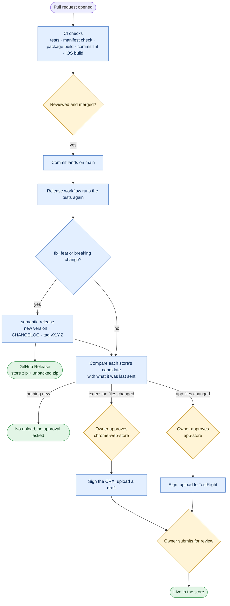

# Releasing

This covers the release workflow, and the browser extension's Chrome Web Store uploads. The iOS app's TestFlight and
App Store steps are in [APP_STORE.md](APP_STORE.md).

Releases are automated with [semantic-release](https://semantic-release.gitbook.io/), driven by
[Conventional Commits](https://www.conventionalcommits.org/) on `main`. The workflow is
`.github/workflows/release.yml` and the config is `voucherboard/release.config.cjs`.

## From pull request to the stores



Yellow steps are done by the owner, blue ones are automatic, and green ones are where a release
ends up. Signing the CRX only happens when `CWS_VERIFIED_CRX` is `true`.

## How a release happens

1. A pull request runs CI (`ci.yml`), commit lint (`commitlint.yml`) and, if it touches the app, the iOS build
   (`ios.yml`).
2. When a commit lands on `main`, `release.yml` runs the tests, then `npx semantic-release` in
   `voucherboard/`, which:
   - works out from the commit messages since the last tag whether to release, and how big a bump;
   - updates `CHANGELOG.md`, and the version in `package.json` and the lockfile (nothing is
     published to npm);
   - runs `scripts/set-manifest-version.mjs`, which sets `manifest.json`'s `version` and
     `version_name`, then `npm run package`, which builds `dist/voucherboard-<version>.zip` (for the
     store) and `dist/voucherboard-<version>-unpacked.zip` (for Load unpacked);
   - commits those files as `chore(release): <version> [skip ci]` and tags `v<version>`;
   - creates a GitHub Release with both zips.
3. The `changes` job runs `scripts/store-changes.mjs`, which decides per store whether there's anything new, and
   writes why in the run summary. See [What counts as a change](#what-counts-as-a-change).
4. Each store with something new gets an upload job that waits for the owner's approval of its environment
   (`chrome-web-store`, `app-store`). Approve it, or reject it to skip that upload. A store with nothing new is
   skipped without asking.
5. The owner submits the draft (Chrome Web Store) or the TestFlight build (App Store Connect) for review. CI never
   submits.

## What counts as a change

Timestamps never count, only content. The baseline is what each store was last sent: the newest successful
deployment to its environment. Each upload job records what it sent as the deployment's URL (the release tag, or
the commit for iOS).

| Store | Candidate | Compared with the last upload | Doesn't count |
| --- | --- | --- | --- |
| Chrome Web Store | The latest release's store zip | Each file's SHA-256, from the two GitHub Releases' zips | `manifest.json`'s `version`, `version_name` and `key` |
| App Store (TestFlight) | The release tag this run made, or else the pushed commit | `git diff` over `mobile/ios`, `mobile/www`, `mobile/council` and the `src` files `project.yml` copies into the app | `package.json`'s version, `mobile/ios/AppStore/`, Markdown, `.gitignore` |

The iOS app is compared by its inputs because signed builds differ every time, even with nothing changed.

A Chrome Web Store upload always needs a new version, since the store only accepts a higher one. Extension changes
in `refactor:` or `chore:` commits wait for the next `fix:` or `feat:` release.

Each store's upload job runs one at a time. If you push again while an approval is waiting, the newer run waits
behind it, then checks again before uploading, so the same version isn't sent twice. Rejecting the older approval
lets the newer run go ahead.

## Forcing an upload

To offer an upload even though nothing changed, for example after a store rejected a draft, run the release
workflow on `main`:

```sh
gh workflow run release.yml --ref main -f force=chrome   # or ios, firefox, safari, or all
```

It still waits for your approval. semantic-release runs too, and releases only if there are unreleased `fix:` or
`feat:` commits. A failed upload doesn't move the baseline, so the next push offers it again; it can also be re-run
from the Actions UI.

## Commit types and version bumps

The commit analyser uses the Angular preset (semantic-release's default):

| Commit prefix | Bump |
| --- | --- |
| `fix:` | patch |
| `feat:` | minor |
| any type with a `BREAKING CHANGE:` footer, or `!` after the type (`feat!:`) | major |
| `docs:`, `chore:`, `refactor:`, `style:`, `test:`, `ci:`, `build:` | none |
| `perf:` | patch |

Commit messages are checked on every push and pull request, so a malformed type fails CI instead
of silently not releasing. To check locally, run `npm run commitlint`.

## `version_name` while in beta

`scripts/set-manifest-version.mjs` sets `version_name` to `"<version> beta"` while the extension
is pre-1.0. For the 1.0.0 release, change the script to drop the suffix.

## Chrome Web Store uploads

The `chrome-web-store` job uses the
[Chrome Web Store API v2](https://developer.chrome.com/docs/webstore/using-api):

1. Checks again that the version is still new (an earlier run may have sent it while this one waited), then
   downloads the release's store zip from its GitHub Release.
2. If `CWS_VERIFIED_CRX` is `true`, signs it as a CRX with Chrome (`--pack-extension`).
3. Gets a short-lived Google access token through Workload Identity Federation.
4. Uploads the package, waits until the upload has been processed, and fails unless it succeeded.

If any of the settings below is missing, the job fails and nothing is uploaded.

| Name | Kind | Value |
| --- | --- | --- |
| `CWS_PUBLISHER_ID` | variable | Developer Dashboard → Account |
| `CWS_EXTENSION_ID` | variable | `cldhejnblckejbeebjidikhebdfnncak` |
| `GCP_WIF_PROVIDER` | variable | The Workload Identity Federation provider's resource name |
| `CWS_SERVICE_ACCOUNT` | variable | The service account's email, also added in Developer Dashboard → Account |
| `CWS_VERIFIED_CRX` | variable | `true` to sign and upload a CRX; unset uploads the zip |
| `CWS_CRX_KEY` | secret | The CRX signing key, needed only when `CWS_VERIFIED_CRX` is `true` |

## Firefox

The Firefox build is the same files with a manifest made at package time (`npm run package:firefox`); CI builds and
lints it on every change. After a release whose Firefox files changed (`src`, `guide`, `icons`, `manifest.json` apart
from its version, the Firefox build scripts), `release.yml` runs `firefox-amo.yml`, which waits for the owner's approval
of the `firefox-amo` environment, then builds the zip from the release tag, runs `web-ext lint` and AMO's validator,
and keeps the zip as the run's artifact. It never creates an AMO version, because a listed version is submitted for
review as soon as it's created; the owner uploads the zip in the Developer Hub. Force one with `-f force=firefox`.
Setup, the listing and each release's steps are in [FIREFOX.md](FIREFOX.md).

## Safari

The Safari app for macOS isn't in a store: it's signed with Developer ID, notarised, and attached to the GitHub release
as `Voucherboard-Safari-<version>.zip`. `store-changes.mjs` compares the latest release's Safari inputs (`safari/`,
`src`, `guide`, `icons`, and `manifest.json` without its version fields) with the release last signed, and the `safari`
job (`safari-release.yml`) waits for the owner's approval of the `safari` environment. `force=safari` offers it anyway.
Setup, secrets and the manual fallback are in [SAFARI.md](SAFARI.md).
