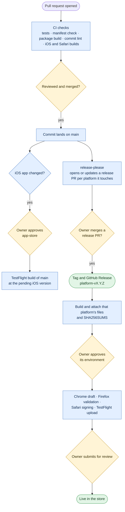

# Releasing

This covers the release workflow, and the browser extension's Chrome Web Store uploads. The iOS app's TestFlight and
App Store steps are in [APP_STORE.md](APP_STORE.md).

Each platform releases on its own, with its own version, changelog and tag, through
[release-please](https://github.com/googleapis/release-please) in manifest mode, driven by
[Conventional Commits](https://www.conventionalcommits.org/) on `main`. The workflow is `.github/workflows/release.yml`;
the config is `release-please-config.json`, and each platform's current version is in `.release-please-manifest.json`.
Release-please never pushes to `main`: every release is a pull request the owner merges.

| Platform | Component and tag | Version file | Changelog | Release files |
| --- | --- | --- | --- | --- |
| Chrome | `chrome`, `chrome-vX.Y.Z` | `extension/manifest.json` | `extension/CHANGELOG.md` | Store zip, unpacked zip, `SHA256SUMS` |
| Firefox | `firefox`, `firefox-vX.Y.Z` | `apps/firefox/version.json` | `apps/firefox/CHANGELOG.md` | AMO zip, `SHA256SUMS` |
| Safari | `safari`, `safari-vX.Y.Z` | `MARKETING_VERSION` in `apps/safari/project.yml` | `apps/safari/CHANGELOG.md` | Signed app zip, `SHA256SUMS` |
| iOS | `ios`, `ios-vX.Y.Z` | `MARKETING_VERSION` in `apps/mobile/ios/project.yml` | `apps/mobile/ios/CHANGELOG.md` | None: the build goes to TestFlight |

The root `CHANGELOG.md` is frozen at 0.13.2, the last version every platform shared (tags `v*`, kept).

## Which platforms a change releases

Paths decide, not commit scopes. A `fix:` or `feat:` commit releases every platform whose files it touches:

| Platform | Its folder | Shared files it also counts |
| --- | --- | --- |
| Chrome | `extension/` | `scripts/package.mjs` |
| Firefox | `apps/firefox/` | `extension/manifest.json`, `src`, `guide`, `icons`, `scripts/package-firefox.mjs`, `scripts/lib/firefox-manifest.mjs` |
| Safari | `apps/safari/` | `extension/manifest.json`, `src`, `guide`, `icons` |
| iOS | `apps/mobile/ios/`, less `AppStore/` | `apps/mobile/www` and `council` (the shared mobile code), and the `extension/src` files the app ships: those `apps/mobile/www/engine.html` loads, and `buyfill.js` (council view) |

So a fix to `extension/src/planner.js` releases all four; one to `extension/src/app.js` (the extension's UI) releases
Chrome, Firefox and Safari; one to `apps/mobile/www/views.js` releases iOS only. `test/release.test.js` fails if the iOS
list drifts from what the app loads. Android, when it lands in `apps/mobile/android`, gets its own package with the
same shared paths, so a change to `www` releases both apps and one under `ios/` or `android/` releases only that app.

Release-please 17 can only count a package's own folder (`additional-paths` is
[still a proposal](https://github.com/googleapis/release-please/pull/2534)), so `scripts/release-please.mjs` runs it
with one addition: each commit's files gain a stand-in under every package whose `additional-paths` they match
(`scripts/lib/release-paths.mjs`). Everything else is release-please as the action runs it. Once release-please
supports `additional-paths`, switch to `googleapis/release-please-action` and delete the wrapper.

Dependabot's updates release nothing: the root `package.json` and lockfile are dev tools only (the extension has no
build step and no dependencies), and `.github/` ships in no artefact. Their `chore(deps)` and `chore(ci)` commits
wouldn't release anything anyway.

## From pull request to the stores



Yellow steps are done by the owner, blue ones are automatic, and green ones are where a release
ends up.

## How a release happens

1. A pull request runs CI (`ci.yml`), commit lint (`commitlint.yml`) and, if it touches them, the iOS and Safari
   builds (`ios.yml`, `safari.yml`).
2. When a commit lands on `main`, `release.yml` runs the tests, then `scripts/release-please.mjs` with the release App's
   token, which:
   - creates the tag and GitHub Release for any release pull request just merged;
   - opens or updates one release pull request per platform with unreleased `fix:`, `feat:` or breaking commits,
     titled `chore(main): release <platform> X.Y.Z`. It bumps that platform's version file, its changelog and
     `.release-please-manifest.json`, and nothing else.
3. The owner merges a release pull request when that platform should ship. Several can wait open at once.
4. That merge's run tags `<platform>-vX.Y.Z`. For Chrome and Firefox, a job builds the files from the tag and attaches
   them with `SHA256SUMS`; Safari's are built and attached by `safari-release.yml`, after approval.
5. The platform's store job waits for the owner's approval of its environment (`chrome-web-store`, `firefox-amo`,
   `safari`, `app-store`). Approve it, or reject it to skip. Each first checks (`scripts/deployed.mjs`) that the
   release hasn't already gone, so a re-run doesn't send it twice.
6. The owner submits the Chrome draft, the AMO upload or the TestFlight build for review. CI never submits.

Each push that changes the iOS app also offers a TestFlight build of `main` at the pending iOS version: see
[APP_STORE.md](APP_STORE.md#8-upload-to-testflight-you-approve-it-ci-does-it).

## Release files

Every file a release ships is attached to its own platform's GitHub Release, built once from the tag, and the store
jobs use those files rather than rebuilding them. Each release's `SHA256SUMS` covers that release's files only.

| File | Release | Built by | Used by |
| --- | --- | --- | --- |
| `voucherboard-chrome-<version>.zip` | `chrome-v*` | `release.yml` `chrome-files` (`npm run package`) | `chrome-release.yml`: uploaded to the Chrome Web Store (signed as a CRX first when `CWS_VERIFIED_CRX` is `true`) |
| `voucherboard-chrome-<version>-unpacked.zip` | `chrome-v*` | `chrome-files` | People loading it unpacked (the guide's Install section) |
| `voucherboard-firefox-<version>.zip` | `firefox-v*` | `release.yml` `firefox-files` (`npm run package:firefox`) | `firefox-release.yml` lints and validates it; the owner uploads it to AMO |
| `voucherboard-safari-<version>.zip` | `safari-v*` | `safari-release.yml`: signed, notarised, stapled | People on a Mac; the Safari app's update check (`src/updates.js`) |
| `SHA256SUMS` | each | the same job | `sha256sum -c SHA256SUMS`; the store jobs check their zip against it |

The iOS app goes to App Store Connect and isn't attached. CI's own runs keep test builds of the zips as the
`voucherboard-dist` artifact for 14 days; they never reach a store. The shared `v*` releases, up to 0.13.2, carry every
platform's zips and one `SHA256SUMS`; those before 0.8 have `voucherboard-<version>.zip` and no Firefox zip.

## Offering an upload again

To offer a release's upload again, for example after a store rejected a draft or an approval timed out, run the
release workflow on `main`:

```sh
gh workflow run release.yml --ref main -f upload=chrome -f tag=chrome-v0.14.0   # or firefox, safari, ios
```

It skips the "already sent" check, and still waits for your approval. A failed or rejected upload records no success,
so a plain re-run from the Actions UI works too.

## Commit types and version bumps

release-please's defaults:

| Commit prefix | Bump |
| --- | --- |
| `fix:`, `perf:` | patch |
| `feat:` | minor |
| any type with a `BREAKING CHANGE:` footer, or `!` after the type (`feat!:`) | major, so 1.0.0 from 0.x |
| `docs:`, `chore:`, `refactor:`, `style:`, `test:`, `ci:`, `build:` | none |

A scope (`fix(ios):`) is welcome, and commit lint warns about unknown ones, but the files decide what releases. Commit
messages are checked on every push and pull request, so a malformed type fails CI instead of silently not releasing.
To check locally, run `npm run commitlint`. To see what release-please would do with `main` (read-only, uses
`gh auth token`): `npm run release:dry-run`.

Every platform starts at 0.13.2, the last shared version (iOS's 0.13.2 build was uploaded from `v0.13.2` before the
switch), so the first release of each is 0.13.3 or 0.14.0, whatever its commits say.

## `version_name` while in beta

`scripts/package.mjs` adds `version_name` `"<version> beta"` to both Chrome zips while the extension is pre-1.0, so
`extension/manifest.json` has only `version`, which release-please keeps. For the 1.0.0 release, drop `BETA` there.
Firefox and Safari don't use `version_name`.

## Chrome Web Store uploads

`chrome-release.yml` uses the
[Chrome Web Store API v2](https://developer.chrome.com/docs/webstore/using-api):

1. Checks that the release hasn't been uploaded already (an earlier run may have sent it while this one waited),
   before asking for approval. Then downloads the release's store zip and checks it against `SHA256SUMS`.
2. If `CWS_VERIFIED_CRX` is `true`, signs it as a CRX with Chrome (`--pack-extension`).
3. Gets a short-lived Google access token through Workload Identity Federation.
4. Uploads the package, waits until the upload has been processed, and fails unless it succeeded.

If any of the settings below is missing, the job fails and nothing is uploaded.

| Name | Kind | Value |
| --- | --- | --- |
| `CWS_PUBLISHER_ID` | variable | Developer Dashboard → Account |
| `CWS_EXTENSION_ID` | variable | `cldhejnblckejbeebjidikhebdfnncak` |
| `GCP_WIF_PROVIDER` | variable | The Workload Identity Federation provider's resource name |
| `CWS_SERVICE_ACCOUNT` | variable | The service account's email, also added in Developer Dashboard → Account |
| `CWS_VERIFIED_CRX` | variable | `true` to sign and upload a CRX; unset uploads the zip |
| `CWS_CRX_KEY` | secret | The CRX signing key, needed only when `CWS_VERIFIED_CRX` is `true` |

## Firefox

The Firefox build is the same files with a manifest made at package time (`npm run package:firefox`), with Firefox's own
version from `apps/firefox/version.json`; CI builds and lints it on every change. For each `firefox-v*` release,
`release.yml` attaches the zip and runs `firefox-release.yml`, which waits for the owner's approval of the
`firefox-amo` environment, then downloads the release's zip, checks it against `SHA256SUMS`, and runs `web-ext lint`
and AMO's validator on it. It never creates an AMO version, because a listed version is submitted for review as soon
as it's created; the owner uploads the release's zip in the Developer Hub. Setup, the listing and each release's steps
are in [FIREFOX.md](FIREFOX.md).

## Safari

The Safari app for macOS isn't in a store: for each `safari-v*` release, `safari-release.yml` waits for the owner's
approval of the `safari` environment, then signs it with Developer ID, notarises it, and attaches
`voucherboard-safari-<version>.zip` and `SHA256SUMS` to the release. Its version is `MARKETING_VERSION` in
`apps/safari/project.yml`, which the app, its extension and the extension's copied `manifest.json` all take, and its
build number a UTC timestamp. Setup, secrets and the manual fallback are in [SAFARI.md](SAFARI.md).

## Website

`pages.yml` builds https://voucherboard.mariusrubin.com from `site/` and the guide (`node scripts/render-pages.mjs`)
on every push to `main` that touches them, and deploys it to GitHub Pages. Pull requests build it without deploying.
Nothing built is committed. It needs **Settings > Pages > Build and deployment > Source: GitHub Actions**, and the
custom domain set there (`site/CNAME` holds it too).
