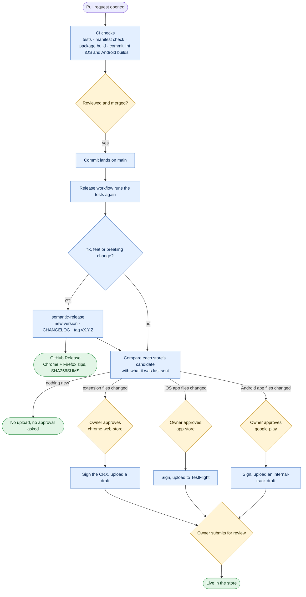

# Releasing

This covers the release workflow, and the browser extension's Chrome Web Store uploads. The iOS app's TestFlight and
App Store steps are in [APP_STORE.md](APP_STORE.md), and the Android app's Google Play steps in
[GOOGLE_PLAY.md](GOOGLE_PLAY.md).

Releases are automated with [semantic-release](https://semantic-release.gitbook.io/), driven by
[Conventional Commits](https://www.conventionalcommits.org/) on `main`. The workflow is
`.github/workflows/release.yml` and the config is `release.config.cjs`.

## From pull request to the stores



Yellow steps are done by the owner, blue ones are automatic, and green ones are where a release
ends up. Signing the CRX only happens when `CWS_VERIFIED_CRX` is `true`.

## How a release happens

1. A pull request runs CI (`ci.yml`), commit lint (`commitlint.yml`) and, if it touches the apps, the iOS and Android
   builds (`ios.yml`, `android.yml`).
2. When a commit lands on `main`, `release.yml` runs the tests, then `npx semantic-release`, which:
   - works out from the commit messages since the last tag whether to release, and how big a bump;
   - updates `CHANGELOG.md`, and the version in `package.json` and the lockfile (nothing is
     published to npm);
   - runs `scripts/set-manifest-version.mjs`, which sets `extension/manifest.json`'s `version` and
     `version_name`, then `npm run dist`, which builds the Chrome and Firefox zips and `SHA256SUMS` in `dist/`;
   - commits those files as `chore(release): <version> [skip ci]` and tags `v<version>`;
   - creates a GitHub Release with the zips and `SHA256SUMS` (see [Release files](#release-files)).
3. The `changes` job runs `scripts/store-changes.mjs`, which decides per store whether there's anything new, and
   writes why in the run summary. See [What counts as a change](#what-counts-as-a-change).
4. Each store with something new gets an upload job that waits for the owner's approval of its environment
   (`chrome-web-store`, `app-store`, `google-play`, `firefox-amo`, `safari`). Approve it, or reject it to skip that
   upload. A store with nothing new is skipped without asking.
5. The owner submits the draft (Chrome Web Store) or the TestFlight build (App Store Connect) for review, and rolls
   out the internal-track draft (Play Console). CI never submits or rolls out.

## Release files

Every file a release ships is attached to its GitHub Release, built once, and the store jobs use those files rather
than rebuilding them.

| File | Built by | Used by |
| --- | --- | --- |
| `voucherboard-chrome-<version>.zip` | semantic-release (`npm run dist`) | `chrome-release.yml`: uploaded to the Chrome Web Store (signed as a CRX first when `CWS_VERIFIED_CRX` is `true`) |
| `voucherboard-chrome-<version>-unpacked.zip` | semantic-release | People loading it unpacked (the guide's Install section) |
| `voucherboard-firefox-<version>.zip` | semantic-release | `firefox-release.yml` lints and validates it; the owner uploads it to AMO |
| `voucherboard-safari-<version>.zip` | `safari-release.yml`: signed, notarised, stapled | People on a Mac. Only on releases whose Safari app changed |
| `SHA256SUMS` | semantic-release; `safari-release.yml` rewrites it to add the Safari zip | `sha256sum -c SHA256SUMS`; the store jobs check their zip against it |

The iOS and Android apps go to App Store Connect and Google Play, and aren't attached. CI's own runs keep the zips
as the `voucherboard-dist` artifact for 14 days. Releases before 0.8 have `voucherboard-<version>.zip` and `-unpacked.zip`, a separate
`Voucherboard-Safari-<version>.zip.sha256`, and no Firefox zip.

## What counts as a change

Timestamps never count, only content. The baseline is what each store was last sent: the newest successful
deployment to its environment. Each upload job records what it sent as the deployment's URL (the release tag, or
the commit for an iOS test build).

| Store | Candidate | Compared with the last upload | Doesn't count |
| --- | --- | --- | --- |
| Chrome Web Store | The latest release's store zip | Each file's SHA-256, from the two GitHub Releases' zips | `manifest.json`'s `version`, `version_name` and `key` |
| App Store (TestFlight) | The latest release tag | `git diff` over `apps/mobile/ios`, `apps/mobile/www`, `apps/mobile/council` and the `extension/src` files `project.yml` copies into the app | `package.json`'s version, `apps/mobile/ios/AppStore/`, Markdown, `.gitignore` |
| Google Play (internal track) | The latest release tag | `git diff` over `apps/mobile/android`, `apps/mobile/www`, `apps/mobile/council` and the `extension/src` files `build.gradle.kts` copies into the app | `apps/mobile/android/PlayStore/`, Markdown, `.gitignore` |

Every store's candidate is a release tag: nothing reaches a store from an untagged commit through `release.yml`.
TestFlight test builds of any commit are a separate, manual workflow (`testflight.yml`, see
[APP_STORE.md](APP_STORE.md#test-builds)); the next release is compared with whatever was uploaded last.

The iOS and Android apps are compared by their inputs because signed builds differ every time, even with nothing
changed. Paths are matched in both layouts (before and after the move to `extension/` and `apps/`), and a file that only moved,
unchanged, doesn't count.

A Chrome Web Store upload always needs a new version, since the store only accepts a higher one. Extension changes
in `refactor:` or `chore:` commits wait for the next `fix:` or `feat:` release.

Each store's upload job runs one at a time. If you push again while an approval is waiting, the newer run waits
behind it, then checks again before uploading, so the same version isn't sent twice. Rejecting the older approval
lets the newer run go ahead.

## Forcing an upload

To offer an upload even though nothing changed, for example after a store rejected a draft, run the release
workflow on `main`:

```sh
gh workflow run release.yml --ref main -f force=chrome   # or ios, android, firefox, safari, or all
```

It still waits for your approval. semantic-release runs too, and releases only if there are unreleased `fix:` or
`feat:` commits. A failed upload doesn't move the baseline, so the next push offers it again; it can also be re-run
from the Actions UI.

## Commit types and version bumps

The commit analyser uses the Angular preset (semantic-release's default):

| Commit prefix | Bump |
| --- | --- |
| `fix:` | patch |
| `feat:` | minor |
| any type with a `BREAKING CHANGE:` footer, or `!` after the type (`feat!:`) | major |
| `docs:`, `chore:`, `refactor:`, `style:`, `test:`, `ci:`, `build:` | none |
| `perf:` | patch |

Commit messages are checked on every push and pull request, so a malformed type fails CI instead
of silently not releasing. To check locally, run `npm run commitlint`.

## `version_name` while in beta

`scripts/set-manifest-version.mjs` sets `version_name` to `"<version> beta"` while the extension
is pre-1.0. For the 1.0.0 release, change the script to drop the suffix.

## Chrome Web Store uploads

`chrome-release.yml` uses the
[Chrome Web Store API v2](https://developer.chrome.com/docs/webstore/using-api):

1. Checks again that the version is still new (an earlier run may have sent it while this one waited), before asking
   for approval. Then downloads the release's store zip and checks it against `SHA256SUMS`.
2. If `CWS_VERIFIED_CRX` is `true`, signs it as a CRX with Chrome (`--pack-extension`).
3. Gets a short-lived Google access token through Workload Identity Federation.
4. Uploads the package, waits until the upload has been processed, and fails unless it succeeded.

If any of the settings below is missing, the job fails and nothing is uploaded.

| Name | Kind | Value |
| --- | --- | --- |
| `CWS_PUBLISHER_ID` | variable | Developer Dashboard → Account |
| `CWS_EXTENSION_ID` | variable | `cldhejnblckejbeebjidikhebdfnncak` |
| `GCP_WIF_PROVIDER` | variable | The Workload Identity Federation provider's resource name |
| `CWS_SERVICE_ACCOUNT` | variable | The service account's email, also added in Developer Dashboard → Account |
| `CWS_VERIFIED_CRX` | variable | `true` to sign and upload a CRX; unset uploads the zip |
| `CWS_CRX_KEY` | secret | The CRX signing key, needed only when `CWS_VERIFIED_CRX` is `true` |

## Firefox

The Firefox build is the same files with a manifest made at package time (`npm run package:firefox`); CI builds and
lints it on every change, and every release carries it. After a release whose Firefox files changed (`src`, `guide`,
`icons`, `manifest.json` apart from its version, the Firefox build scripts), `release.yml` runs `firefox-release.yml`,
which waits for the owner's approval of the `firefox-amo` environment, then downloads the release's zip, checks it
against `SHA256SUMS`, and runs `web-ext lint` and AMO's validator on it. It never creates an AMO version, because a
listed version is submitted for review as soon as it's created; the owner uploads the release's zip in the Developer
Hub. Force one with `-f force=firefox`.
Setup, the listing and each release's steps are in [FIREFOX.md](FIREFOX.md).

## Safari

The Safari app for macOS isn't in a store: it's signed with Developer ID, notarised, and attached to the GitHub release
as `voucherboard-safari-<version>.zip`, with `SHA256SUMS` rewritten to include it. `store-changes.mjs` compares the
latest release's Safari inputs (`apps/safari/`, `extension/src`, `guide`, `icons`, and `manifest.json` without its
version fields) with the release last signed, and the `safari`
job (`safari-release.yml`) waits for the owner's approval of the `safari` environment. `force=safari` offers it anyway.
Setup, secrets and the manual fallback are in [SAFARI.md](SAFARI.md).

## Website

`pages.yml` builds https://voucherboard.mariusrubin.com from `site/` and the guide (`node scripts/render-pages.mjs`)
on every push to `main` that touches them, and deploys it to GitHub Pages. Pull requests build it without deploying.
Nothing built is committed. It needs **Settings > Pages > Build and deployment > Source: GitHub Actions**, and the
custom domain set there (`site/CNAME` holds it too).
