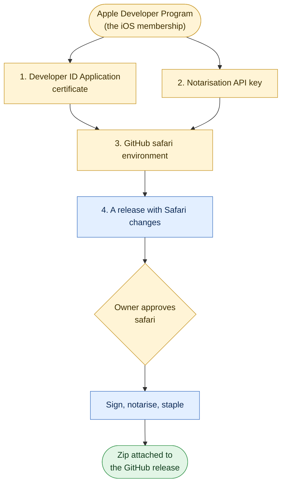

# Voucherboard for Safari

The steps to ship Voucherboard as a Safari web extension on the Mac, outside the Mac App Store: a small app that holds
the extension, signed with your Developer ID, notarised by Apple, and attached to the GitHub release as a zip. Nothing
goes to the Mac App Store and there's no App Review. Every step says who does it:

| Tag | Who | Means |
| --- | --- | --- |
| **YOU** | Marius | Only the account holder can do it: certificates, keys, approving a release |
| **CLAUDE** | A coding session | Code or document changes in this repo, on request |
| **CI** | GitHub Actions | Runs by itself, or when you start it |



## What's there

- `voucherboard/safari/`: the XcodeGen project (`project.yml`). The app (`App/VoucherboardApp.swift`) is one window: it
  says whether the extension is on, how to turn it on and allow it on parkingpermits.lewisham.gov.uk, and has a button
  that opens Safari's extension settings. The extension target (`Extension/`) only holds Safari's required handler.
- The extension's files aren't copied into git. On every build, `safari/extension.sh` copies `manifest.json` (without
  Chrome's `key`), `src`, `guide` and `icons` from `voucherboard/` into the extension, and both bundles take
  `manifest.json`'s version. `test/safari.test.js` checks this.
- Bundle ids: `com.mariusrubin.voucherboard.mac` (app) and `com.mariusrubin.voucherboard.mac.extension`, apart from the
  iOS app's. Developer ID apps don't need them registered or a provisioning profile.
- macOS 13 or later. App sandbox on both, hardened runtime on both (notarisation needs it).
- `.github/workflows/safari.yml` builds it unsigned on every change. `.github/workflows/safari-release.yml`, called by
  `release.yml`, signs, notarises, staples and attaches it, after you approve the `safari` environment.

## Safari compatibility

The extension uses `chrome.runtime.getManifest`, `chrome.runtime.getURL`, and `chrome.storage.local` `get`, `set` and
`remove` with promises. Safari supports all of them under the `chrome` namespace, as well as the manifest's
`content_scripts` (`matches`, `exclude_matches`, `run_at`) and `web_accessible_resources` with `matches`. There's no
background script, popup or native messaging. Differences from Chrome:

- **Per-site permission.** Safari doesn't run the extension on a site until the user allows it (step 4 of
  [Installing](#installing-it)). Until then nothing appears on the council site.
- **Private windows.** Off unless the user allows it in Safari Settings > Extensions.
- **`version_name`** isn't used by Safari. The app's version is the manifest's `version`.
- **The extension's own wording still says Beta** (the launcher, header and footer come from `src`, shared with Chrome).
  Only the containing app avoids the word.
- **Not yet tried in Safari:** the planner itself, loading `src/app.css` by `fetch` from the content script (it falls
  back to a `<link>`), the Guide link (a `safari-web-extension://` page opened in a new tab), and the Buy hand-off.
  Check these on the council site first.

---

## 1. Developer ID Application certificate **YOU** (about 15 minutes, every 5 years)

Only the account holder can make one. It's separate from the Apple Distribution certificate the iOS app uses. Work in a
folder outside any repo and delete it at the end. Never commit it: `.gitignore` refuses `*.p12`, `*.p8`,
`*.mobileprovision`, `*.cer` and `*.certSigningRequest`.

**On a Mac:** Xcode > Settings > Accounts > your team > **Manage Certificates** > **+** > **Developer ID Application**.
Then in Keychain Access, **My Certificates**, right-click "Developer ID Application: Marius Rubin (TEAMID)" >
**Export** > `devid.p12`, with a long random password.

**Or with OpenSSL:**

```sh
umask 077 && mkdir vb-safari && cd vb-safari
openssl genrsa -out devid.key 2048
openssl req -new -key devid.key -out devid.certSigningRequest -subj "/emailAddress=voucherboard@mariusrubin.com/CN=Marius Rubin/C=GB"
```

At developer.apple.com, **Certificates > +** > **Developer ID Application**, profile type **G2 Sub-CA**, upload
`devid.certSigningRequest`, download `developerID_application.cer`, then:

```sh
openssl x509 -inform DER -in developerID_application.cer -out devid.pem
openssl rand -base64 30          # the .p12 password: save it in your password manager
openssl pkcs12 -export -inkey devid.key -in devid.pem -name "Developer ID Application" \
  -keypbe PBE-SHA1-3DES -certpbe PBE-SHA1-3DES -macalg sha1 -out devid.p12
```

Save `devid.p12` and its password in your password manager. CI adds the Developer ID G2 intermediate itself.

## 2. Notarisation API key **YOU** (about 5 minutes, or none)

`notarytool` signs in with an App Store Connect API key. The **App Manager** key from
[APP_STORE.md](APP_STORE.md) step 6.3 works; reuse it, or make one just for this: App Store Connect > **Users and
Access > Integrations > App Store Connect API > Team Keys > +**, name `GitHub Actions notarise`, access **Developer**.
Download the `.p8` (only once), and note the **Key ID** and **Issuer ID**.

## 3. The GitHub `safari` environment **YOU** (about 10 minutes)

Repository **Settings > Environments > New environment** `safari`:

1. **Required reviewers:** yourself (`maubergine`), with "Prevent self-review" off.
2. **Deployment branches and tags:** Selected branches: `main`.
3. From the `vb-safari` folder:

```sh
R=maubergine/voucherboard
gh variable set APPLE_TEAM_ID --repo $R --env safari --body "<Team ID>"
gh variable set ASC_KEY_ID    --repo $R --env safari --body "<Key ID>"
gh variable set ASC_ISSUER_ID --repo $R --env safari --body "<Issuer ID>"
gh secret set ASC_KEY_P8      --repo $R --env safari < AuthKey_<Key ID>.p8
base64 -i devid.p12 | gh secret set MAC_DEVELOPER_ID_P12 --repo $R --env safari
gh secret set MAC_DEVELOPER_ID_PASSWORD --repo $R --env safari      # paste the .p12 password when asked
```

4. Check the `.p12`, its password and the `.p8` are in your password manager, then `cd .. && rm -rf vb-safari`.

| Name | Kind | Value |
| --- | --- | --- |
| `APPLE_TEAM_ID` | variable | Team ID (developer.apple.com > Membership) |
| `ASC_KEY_ID`, `ASC_ISSUER_ID` | variables | From step 2 |
| `ASC_KEY_P8` | secret | The `.p8` file's text |
| `MAC_DEVELOPER_ID_P12` | secret | The base64 `.p12` from step 1 |
| `MAC_DEVELOPER_ID_PASSWORD` | secret | Its password |

Environment secrets are per environment, so these are set again here even if `app-store` has the same key.

## 4. Releases **CI**, after **YOU** approve

After each push to `main`, `release.yml`'s `changes` job runs `scripts/store-changes.mjs`. If the latest release's
Safari inputs (`safari/`, `src`, `guide`, `icons`, and `manifest.json` apart from its version fields) differ from the
release last signed, the `safari` job waits for your approval. Then `safari-release.yml`:

1. checks again, then checks out the release tag and generates the project;
2. imports the certificate into a throwaway keychain;
3. archives with `Developer ID Application`, exports with method `developer-id`, and checks both bundles are signed by
   your team, with the hardened runtime and a secure timestamp, and not for debugging;
4. submits the app to `notarytool` and waits, staples the ticket, and checks it with `spctl`;
5. attaches `Voucherboard-Safari-<version>.zip` and its `.sha256` to the GitHub release;
6. deletes the keychain and key.

The release URL is recorded on the deployment, and the next run compares with it. Nothing new means no approval asked.
To sign again anyway:

```sh
gh workflow run release.yml --ref main -f force=safari
```

Releases with no Safari changes get no Safari zip. Point users at the newest release that has one.

## Building by hand **YOU** (fallback)

Xcode 27 and XcodeGen (`brew install xcodegen`), from `voucherboard/safari`:

```sh
xcodegen generate

# Unsigned check, or ad hoc for your own Safari (needs "Allow unsigned extensions", below)
xcodebuild build -project Voucherboard.xcodeproj -scheme Voucherboard -configuration Release \
  -destination 'generic/platform=macOS' -derivedDataPath build
open build/Build/Products/Release/Voucherboard.app

# Signed and notarised, with the certificate from step 1 in your login keychain
xcodebuild archive -project Voucherboard.xcodeproj -scheme Voucherboard -configuration Release \
  -destination 'generic/platform=macOS' -archivePath build/Voucherboard.xcarchive \
  CODE_SIGN_IDENTITY="Developer ID Application" DEVELOPMENT_TEAM=<Team ID>
cat > build/ExportOptions.plist <<'PLIST'
<?xml version="1.0" encoding="UTF-8"?>
<!DOCTYPE plist PUBLIC "-//Apple//DTD PLIST 1.0//EN" "http://www.apple.com/DTDs/PropertyList-1.0.dtd">
<plist version="1.0"><dict>
  <key>method</key><string>developer-id</string>
  <key>teamID</key><string>TEAM_ID</string>
  <key>signingStyle</key><string>manual</string>
  <key>signingCertificate</key><string>Developer ID Application</string>
</dict></plist>
PLIST
sed -i '' 's/TEAM_ID/<Team ID>/' build/ExportOptions.plist   # your Team ID in place of <Team ID>
xcodebuild -exportArchive -archivePath build/Voucherboard.xcarchive \
  -exportOptionsPlist build/ExportOptions.plist -exportPath build/export
codesign --verify --deep --strict --verbose=2 build/export/Voucherboard.app

# Once: keep the API key in the keychain, then delete the .p8 file
xcrun notarytool store-credentials vb-notary --key AuthKey_<Key ID>.p8 --key-id <Key ID> --issuer <Issuer ID>

ditto -c -k --keepParent build/export/Voucherboard.app build/notarise.zip
xcrun notarytool submit build/notarise.zip --keychain-profile vb-notary --wait
xcrun stapler staple build/export/Voucherboard.app
spctl --assess --type execute --verbose=2 build/export/Voucherboard.app   # "source=Notarized Developer ID"

V=$(node -p 'require("../manifest.json").version')
ditto -c -k --keepParent build/export/Voucherboard.app "build/Voucherboard-Safari-$V.zip"
gh release upload "v$V" "build/Voucherboard-Safari-$V.zip" --repo maubergine/voucherboard --clobber
```

If notarisation is rejected, `xcrun notarytool log <submission id> --keychain-profile vb-notary` says why.
`build/` is ignored by git.

## Installing it

For users, from a signed release:

1. Download `Voucherboard-Safari-<version>.zip` from the GitHub release and open it.
2. Drag **Voucherboard** to Applications, and open it.
3. Click **Open Safari extension settings**, and tick **Voucherboard**.
4. Select Voucherboard, choose **Edit Websites**, and set parkingpermits.lewisham.gov.uk to **Allow**. (Or, on the
   council site, use Voucherboard's button in the toolbar and choose **Always allow on this website**, if Safari
   shows one.)
5. Go to parkingpermits.lewisham.gov.uk and sign in. The Voucherboard button is at the bottom right.

The app can be closed afterwards. Deleting it removes the extension. To update, replace the app with the new one and
open it once.

**Development builds** (`scripts/dev.sh safari`, see [DEVELOPING.md](DEVELOPING.md)) only load with unsigned extensions allowed: Safari > Settings >
Advanced > tick **Show features for web developers**, then Settings > **Developer** > tick **Allow unsigned
extensions** (asks for your password). Safari turns this off again each time it quits.

## What expires

- The Developer ID Application certificate lasts 5 years. Signed and notarised copies keep working after it expires;
  only new signing needs a new one. Replace `MAC_DEVELOPER_ID_P12` and `MAC_DEVELOPER_ID_PASSWORD` when it's renewed.
- The API key doesn't expire until revoked.
- The Apple Developer Program renews yearly. If it lapses, existing notarised copies keep working, but new ones can't
  be signed.
